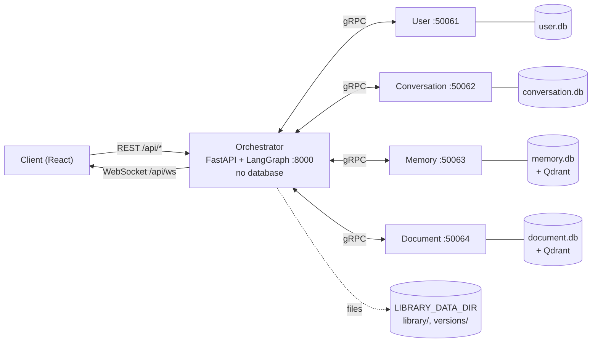

# Agentic RAG

> 📘 Full technical documentation: [`docs/DOCUMENTATION.md`](docs/DOCUMENTATION.md) (architecture, agent workflow, memory, API, configuration,
> and a [guide to every folder and file](docs/DOCUMENTATION.md#6-project-structure-and-file-guide)).

A full-stack agentic RAG app. Users log in, upload documents into a per-user vector store, and chat
with an agent that decides for each message whether to **chat**, **answer from their documents (RAG)**,
**search the web**, or **answer from its own knowledge**. It rewrites and expands weak queries and
checks its own answers before replying.

The same chat also manages the documents: **rename**, **edit** (PDFs in place, keeping their fonts and layout),
**undo** and **redo**, and queues longer jobs ("rename every report by its date") to run in the background.
The **Documents** page does the same with buttons. See [Document library](#document-library).

| Layer | Tech |
|---|---|
| Frontend | React 18 + Vite + Tailwind, `react-markdown` |
| API | FastAPI, one WebSocket for everything pushed to the browser, cookie login (PBKDF2, server-side tokens); no database of its own (each service has its SQLite file) |
| Agent | LangGraph state machine |
| LLMs (Groq) | `openai/gpt-oss-120b`: every reply (answers and small talk), the knowledge gate, answer evaluation, decision reviews. `openai/gpt-oss-20b`: routing and query rewrites. `qwen/qwen3.8-27b`: memory extraction and conversation summaries (own rate limit, no hidden reasoning) |
| Embeddings | Gemini `gemini-embedding-001` (768-d) for documents; Voyage `voyage-4-lite` for conversation memory |
| Reranking | Voyage `rerank-2.5` (hosted); if it can't score, an LLM relevance check is used |
| Vector DB | Qdrant (embedded on-disk by default, or a server via `QDRANT_URL`) |
| Web search | Tavily if `TAVILY_API_KEY` is set, then DuckDuckGo, then Wikipedia |
| Document library | PyMuPDF + fontTools (in-place PDF edits), python-docx, fpdf2 (PDF export), pyphen (hyphenation) |

## Architecture

The browser talks REST to one **orchestrator** (FastAPI + LangGraph, `backend/`), which holds no database. Everything
the server pushes back (chat answers as they are written, indexing progress, the batch queue) goes over one WebSocket
per tab. The orchestrator calls four **gRPC services**, each owning its own data.



| Protocol | Between | What it carries | Where |
|---|---|---|---|
| REST (HTTP/JSON, login cookie) | browser to orchestrator | sign-up and login, `POST /api/chat/stream` (`202`, the answer comes over the socket), conversations, document upload and actions, `/api/library/*`, health | `backend/api/routes/`, `backend/library/api.py` |
| WebSocket `GET /api/ws` | orchestrator to browser | `system` `hello \| resync \| heartbeat \| pong`; `chat` `meta \| status \| step \| draft \| final \| error`; `queue` `task \| changed`; `library` `document` (the browser sends only `{"type":"ping"}`) | `backend/realtime/schema.py` |
| gRPC (`agentic_rag.v1`, plus `grpc.health.v1`) | orchestrator to each service | User 13 RPCs, Conversation 10, Memory 10, Document 49 (ingest and read-pages stream progress); a deadline on every call, the request id as metadata | `protos/agentic_rag_proto/*.proto`, `backend/clients.py` |
| SQL (SQLite, one file per service) | inside a service | User: `users`, `auth_tokens`, `embed_usage`, `api_usage`. Conversation: `conversations`, `messages`. Memory: `user_facts` (+ episodes in its own Qdrant folder). Document: `documents`, `renames`, `edits`, `undone_edits`, `batches`, `batch_tasks`, `sessions`, `page_text`, `query_embeddings` (+ passages in its own Qdrant folder) | `services/<name>/db.py` |

A request costs one `ValidateToken` call to the User service at the door. Measured in one process on loopback
(`python scripts/grpc_overhead.py`, 200 round-trips each, Windows, Python 3.14), the median / 95th percentile is:

| Call | Median | p95 |
|---|---|---|
| `ValidateToken` (User) | 0.75 ms | 0.86 ms |
| `ListConversations` (Conversation) | 0.72 ms | 0.85 ms |
| `auth.user_for` (the whole sign-in check) | 0.76 ms | 0.89 ms |

Across containers or machines the network's own latency is added to each call.

## Agent workflow

```
START → router ─┬─ greeting (small talk) ──────────────────────────────────────────────► END
                ├─ direct ──(knowledge gate refuses)──────────────► fallback
                │     └──(gate passes)───────────────────────────► finalize ► END
                ├─ rag ──(vague?)► rewrite ► retrieve ► grade ──(high)► generate_rag ► evaluate ► finalize ► END
                │                     ▲                    │(mid: one reworded retry)       │(insufficient)
                │                     └────────────────────┘                                ▼
                │                              (low / failed) ──────────────────────────► fallback
                └─ web_search ► generate_web ► evaluate ──(insufficient)► rewrite ► web_search …
   fallback ──► next untried source for the user's preference ──► … ──(all tried)► best answer or "no results"
```

- **Router** (20B) classifies small talk vs. information request, picks the preferred source (documents, web,
  model knowledge, or auto), flags vague queries, and rewrites follow-ups into standalone questions.
  The 120B reviews the decision only when the 20B isn't confident.
- **Source order** follows the preference: documents → RAG, model knowledge, web; web → web, RAG, model knowledge;
  auto starts with model knowledge, and the knowledge gate sends questions about the user's own files to RAG.
- **Direct answers** pass a knowledge gate first (120B): time-sensitive, uncertain, or file-specific questions are
  refused and move on to the next source.
- **Retrieve**: hybrid search (dense + BM25, fused with Reciprocal Rank Fusion), filtered to the current user.
- **Grade**: a reranker (Voyage, hosted) scores the candidates. High → answer, mid → one reworded search, low → next source.
  MMR picks diverse passages. If the reranker is unavailable, an LLM relevance check takes over.
- **Generate**: answers only from the selected passages, with `[n]` citations.
- **Evaluate**: document answers on strong evidence, and web answers, are checked in code first (every claim cited, every citation
  real, the cited passage contains the claim). If that passes, no model check is needed; otherwise the 120B checks
  that the answer is sufficient and grounded. If the check itself can't run, the answer is kept and marked unverified.
- **Memory**: facts about the user (name, preferences, …) are stored as key-value rows in SQLite; past exchanges
  are stored as short summaries in a Voyage-embedded Qdrant collection and recalled when relevant.
- **Tokens**: every model call is counted per model and step; each request is logged to `backend/data/token_usage.jsonl`.
- Each node emits a trace step. The UI streams these live and shows them under each answer (**Steps**, next to **Sources**).

## Document library

`backend/library/` (merged in from the renaming pipeline) owns the documents: the catalog, the stored files, indexing,
and every change to them.

- **Routing**: messages about documents ("rename the GDPR one", "fix the typo in my resume", "undo") go to the
  `manage` node, which runs the document agent (120B with tools). Short follow-ups to its last edit or question
  ("regenerate it", "yes", a misspelled "undo") stay with it.
- **Rename**: titles are cleaned and checked; a name another document has is asked about first. The stored file is
  renamed to match, and the search index is updated without re-embedding.
- **Edit** TXT, MD and DOCX directly. **PDFs are edited in place**: the paragraph is re-wrapped in the document's own
  fonts, kerning and justification; content below moves down, onto a new page when needed (headers, footers and page
  numbers follow). Every edit is checked letter by letter, by its whole text and pixel by pixel before it is saved.
  Fonts a PDF lacks are fetched on demand from pinned URLs, verified against `backend/library/fonts/manifest.json`
  (SHA-256), and cached in `backend/data/fonts/`. Quotes typed on a keyboard become the typographic ones when the
  font only has those (TeX's fonts). When the layout can't be kept, the user is asked whether to convert the PDF to a
  Markdown copy, but only when the passage would be found in it.
- **On the website**: a document's preview has **Edit a passage** (select it on the page, or type it) and, for TXT and
  Markdown, **Edit text** (the whole file; refused if it changed meanwhile). Text selected in the preview is matched
  across line-end hyphens, Markdown marks and either kind of quote. The Documents page gives each document one "⋯"
  menu (Rename, Undo / Redo, Download, Remove), each change asking first.
- **Undo / Redo** step back and forward through a document's edits like a browser's Back and Forward. The buttons
  and a misspelled "undo" ask first.
- **Queue**: jobs over many documents run one task at a time, paced to the Groq per-minute limit; the Documents page
  shows them, with Cancel.

### Using the site (for invited users)

1. Open the link you were given and choose **Create account**: a username, a password of 8 characters or more, and the
   invite code you were given.
2. **Documents** → **Upload documents** (PDF, Word, TXT or Markdown, up to 20 MB). Each is titled and indexed; it can
   be asked about once it shows **Ready**.
3. **Chat**: ask about your documents, or ask for changes ("rename the GDPR one", "change 2024 to 2025 in my CV").
   Every change has **Undo** and **Redo** under it.
4. To change a document yourself, open it (its name on the Documents page) and use **Edit a passage**. Each
   document's "⋯" menu has Rename, Undo, Redo, Download and Remove.

Your documents and chats are visible only to you. The site's owner can see how much each account uses (message and
indexing counts, never their content). On a phone, Back closes an open editor, then the preview.

## Measured improvements

Old vs current, from the benchmarks and the token log (details: [`docs/DOCUMENTATION.md` §21](docs/DOCUMENTATION.md#21-measurements-before-and-after)):

| | Old | Current |
|---|---|---|
| Tokens per message (same 9-message test) | 6,645 | 4,344 (−35%); small model −73% |
| Answer prompt trims (8 test questions) | 16,560 tokens | 12,384 (−25%) |
| Relevance checker: right passage in top 5 (74 questions) | 92% (local MiniLM) | 100% (Voyage rerank-2.5) |
| Answerable questions answered from the documents | 65/67 | 67/67 |
| Reranker memory footprint | ~450 MB + torch | none (hosted) |
| Opinion/philosophy questions answered directly | 3/18 | 18/18 |
| Personal scenarios answered as advice plans | 2/2 | 0/10 |
| Memory benchmark (18 conversations) | 18/18 cases, 20,998 tokens | 17/18, 15,984 tokens (−24%); 0 false saves both |
| Memory model called on 80 router test messages | 10 | 2 |
| Memory saves when Qwen misnames its tool (8 tries) | 5/8 | 8/8 |
| Direct-answer prompt, factual questions and small talk | 1,022 tokens | 480 (−53%) |
| Router tokens per message (80 cases) | 962 | 875 (−9%); 73/80 exact either way |
| Knowledge gate prompt per call (31 questions, all correct either way) | ~750 tokens | ~605 (−19%) |
| Web answers calling search results "the sources you provided" (6 repeats) | 1/6 | 0/6; output tokens −11%, same facts |
| Document answers checked without the 120B (43 answers) | 0/43 | 37/43; 0 real problems missed; 187/190 broken answers caught |
| Web answers checked without the 120B (32 answers) | 0/32 | 17/32; 0 real problems missed; 124/128 broken answers caught |
| Identity probes naming the underlying model or provider (33) | 27/33 | 0/33; questions about AI models still answered |
| Persona "Hroptatyr": name given when asked / says "the Wise" | — | 9/9 / 0 |
| Agent tokens, same 8 messages (old code vs new) | 25,825 | 20,583 (−20%); greetings −64%, document requests −39% |
| Router calls on 80 router test messages | 80 | 70 (greetings and first-message document requests decided in code) |
| Memory benchmark, batched extraction (same day) | 17/18, 14,375 tokens | 17/18, 12,180 (−15%); 0 false saves |
| Memory benchmark with one retry on an empty result | 17/18, 19/20 facts (batched 17/18, 16/20) | 18/18, 20/20 (batched 18/18, 20/20); 16,224 tokens (+13%, mostly run-to-run variance; the retry fired once) |

## Repository layout

| Folder | Holds |
|---|---|
| `backend/api/` | HTTP routes (auth, chat, the WebSocket, documents, health) and the login dependency |
| `backend/library/` | The document library: catalog, files, indexing queue, document agent, rename/edit/undo, PDF editing, accounts, batch queue, its own API at `/api/library/*` |
| `backend/config/` | Settings, model clients per role, token accounting |
| `backend/models/` | Thin gRPC clients for chats, facts and accounts, and API schemas |
| `backend/graph/` | The LangGraph agent: state, nodes, edges |
| `backend/tools/` | Answer writers (direct, documents, web), small talk, memory extraction |
| `backend/documents/rag.py` | The orchestrator's client of the Document service's RAG half (index a file, search, delete) |
| `backend/memory/` | Conversation memory (Voyage embeddings in Qdrant) |
| `backend/evaluation/` | Code citation check, LLM answer check, decision reviews |
| `backend/tests/` | Unit tests (no API calls) |
| `services/` | The four gRPC services (`user`, `conversation`, `memory`, `document`) and `common/` (server, config, logging, SQLite helper) |
| `protos/`, `agentic_rag_proto/` | The `.proto` sources and the generated Python code |
| `scripts/` | `run_all.py`, `gen_protos.py`, `grpc_healthcheck.py`, `grpc_overhead.py`, `logs.py`, the `migrate_*.py` scripts, `ci_test_coverage.py` |
| `Dockerfile`, `docker-compose.yml` | One image, one compose file for the whole stack ([Docker](#docker)) |
| `frontend/` | React app: pages, components, API client, chat store; `backend/web.py` serves its build in production |
| `benchmark/` | Benchmark scripts, question sets, corpus, saved results |
| `scripts/experiments/` | One-off model experiments |
| `docs/` | Documentation |

What every file does: [`docs/DOCUMENTATION.md` §6](docs/DOCUMENTATION.md#6-project-structure-and-file-guide).

## Running it

`.env` in the project root:

```
GROQ_API_KEY=...
GEMINI_API_KEY=...
# optional
GROQ_API_KEY_2=...         # up to GROQ_API_KEY_4: keys from other Groq accounts, used when a model's limit runs out
TAVILY_API_KEY=...
VOYAGE_API_KEY=...         # reranking and conversation memory
SIGNUP_CODE=...            # invite code for every sign-up after the first (empty: sign-ups closed)
QDRANT_URL=http://localhost:6333
```

Backend (from the project root):

```bash
python -m venv .venv && .venv\Scripts\activate
pip install -r requirements.txt
python scripts/run_all.py      # the four services and the orchestrator (or: start the services, then `uvicorn app:app --reload`)
```

Frontend:

```bash
cd frontend
npm install
npm run dev          # http://localhost:5173
```

Design preview (no backend or login needed): with `npm run dev` running, open
`http://localhost:5173/preview.html#/chat/c1` (also `#/chat`, `#/documents`, `#/overview`; add `?state=empty`
for a new account or `?state=offline` for the login screen with the server down). It renders the real app with
sample data from `frontend/src/dev/fixtures.js` and is not part of the production build.

Create an account on the login screen (the first one needs no invite code), upload files on **Documents**, then chat.

Production: `cd frontend && npm run build`, then start the backend: it serves the app at `http://localhost:8000`
(`index.html` uncached, the hashed assets cached for a year, scripts, styles and JSON gzipped; pdf.js is bundled, so
nothing loads from a CDN). Making it public over HTTPS: [`docs/DOCUMENTATION.md` §13](docs/DOCUMENTATION.md#13-authentication--security).

Backups: `python -m backend.scripts.backup` (stop the backend first for one that includes the search index; restore steps in
[`docs/DOCUMENTATION.md` §4](docs/DOCUMENTATION.md#4-getting-started)). Take one regularly, e.g. nightly, while invited
users have documents here: a FULL backup needs the backend stopped; restoring a PARTIAL one needs a re-index afterwards.

Tests (no API calls; the PDF layout ones take a few minutes): `pip install -r requirements-dev.txt`, then
`python -m pytest` from the project root.

Model experiments (they call the APIs) live in `scripts/experiments/`; run them from the project root,
e.g. `python -m scripts.experiments.test_gate`.

> The embedded Qdrant store allows only one process at a time. `--reload` is fine, but don't run
> several workers against the same `backend/vector_db/qdrant_data`. Set `QDRANT_URL` to use a Qdrant server instead.

### Everything at once

```bash
python scripts/run_all.py              # the four services, then the orchestrator on :8000; Ctrl+C stops all of them
python scripts/run_all.py --port 8001  # another orchestrator port
python scripts/run_all.py --host 0.0.0.0 --port $PORT   # bind the orchestrator beyond localhost (the services never are)
```

It refuses to start if a port is taken (nothing is killed), starts each service only when the one before answers
`grpc.health.v1` with SERVING, then the orchestrator. `GET /api/health/services` (public) reports each service's
health with `all_up`, and the System page reads it.

### Docker

One image (a Node stage builds `frontend/dist`; the runtime is `python:3.14-slim` with tesseract and the DejaVu fonts,
running as a non-root user) serves the orchestrator and the four services; `docker-compose.yml` picks the command.
Each service has its own named volume for its database and Qdrant folder, the orchestrator has one for the document
files (`LIBRARY_DATA_DIR`), and `logs` is shared. API keys come from `.env` (optional for compose, never copied into the
image: `.dockerignore` leaves it out).

```bash
docker compose up -d --build                  # http://localhost:8000
curl http://localhost:8000/api/health/services   # all_up: true once every service answers its health check
docker compose logs -f orchestrator
docker compose down                           # keeps the volumes; `down -v` deletes the data too
```

The orchestrator starts only after the four services pass their health check (`scripts/grpc_healthcheck.py`), and
refuses to start without `GROQ_API_KEY` and `GEMINI_API_KEY` (the Docker CI job passes dummy ones: nothing there calls a
model). Moving data from an older install into the volumes means running the migrations below against the published
service ports, which compose does not publish; run them before switching to Docker, or add `ports:` to the services.

### Deploying (Render + Vercel)

The backend (four gRPC services + orchestrator) runs as ONE Docker web service on Render with one persistent disk
(`/data`: the services' databases and Qdrant folders, document files, logs); the built frontend runs on Vercel, which
forwards `/api/*` to Render, so the login cookie stays first-party on the Vercel domain (`SameSite=Lax`, `Secure`).
Vercel cannot proxy WebSockets, so the page asks `POST /api/ws/ticket` (over that proxy) for a one-time 60-second
ticket and opens `wss://<render>/api/ws?ticket=...` directly; logging out still closes that socket. The Render service
also serves the same site at its own `onrender.com` address, with the plain cookie path, if you want to skip Vercel.
It starts with no data, and costs Render's *Starter* plan plus 1 GB of disk.

1. **Render, backend.** dashboard.render.com > **New** > **Blueprint** > connect the GitHub repo > branch
   `microservices` > Render reads `render.yaml`. Fill the prompted variables (the rest are set by the file):
   `GROQ_API_KEY`, `GEMINI_API_KEY` (both required), optional `GROQ_API_KEY_2..4`, `GEMINI_API_KEY_2..4`,
   `VOYAGE_API_KEY` (reranking and memory), `TAVILY_API_KEY`, `BOT_CONTACT`; `SIGNUP_CODE` (invite code for every
   sign-up after the first; empty = closed), `ADMIN_USERNAMES` (comma-separated accounts that get the Admin page);
   `CORS_ORIGINS`: type `https://placeholder.invalid` for now. **Apply**. The first build takes several minutes; the
   service is live when `https://<name>.onrender.com/api/health` answers. Note that hostname.
2. **Vercel, frontend.** Edit `frontend/vercel.json`: replace `RENDER_HOST` with the hostname from step 1
   (`<name>.onrender.com`, no `https://`; Vercel cannot read environment variables in a rewrite destination), commit,
   push to `microservices`. vercel.com > **Add New** > **Project** > import the repo > **Root Directory** `frontend`
   (Vite is detected; build `npm run build`, output `dist` come from `vercel.json`) > **Environment Variables**:
   `VITE_WS_URL` = `wss://<name>.onrender.com/api/ws` > **Deploy**. Settings > Git > **Production Branch**:
   `microservices` (or merge it to `main`). Note the production domain (`https://<project>.vercel.app`).
3. **Render again.** Service > **Environment**: `CORS_ORIGINS` = `https://<project>.vercel.app` (comma-separate a custom
   domain; no trailing slash). It is what lets the browser's `Origin` through the cross-site check on every change
   (POST/PUT/DELETE arrive from the Vercel origin) and on the WebSocket. `ALLOWED_HOSTS` is already
   `*.onrender.com`; set it to your exact `<name>.onrender.com` to tighten it (add a custom API domain if you use one).
   **Save, rebuild and deploy**.
4. **First account.** Open the Vercel URL: the first sign-up needs no code and is yours; later ones need `SIGNUP_CODE`.
   To open the Admin page, put that username in `ADMIN_USERNAMES` (after it exists) and redeploy.

Behind the two proxies: uvicorn trusts `X-Forwarded-*` (`FORWARDED_ALLOW_IPS=*`, so Render's `Host`/protocol are right
and the cookie gets `Secure`); the login limiter counts per username as well as per address, because the address
comes from a forwarded header. Vercel's limits that matter here: a proxied (rewritten) request may take at most 120 s
(chat answers arrive over the socket, the POST returns 202 at once), and its docs state no body limit for rewrites to
an external origin (the 4.5 MB limit is for Vercel Functions). Direct-to-Render uploads are therefore not
built; if a 20 MB upload is ever refused through Vercel, upload from the `onrender.com` address instead. Starter's disk
is single-instance: don't scale beyond one instance (embedded Qdrant and the in-memory hub assume one process).
Render redeploys restart the service; data on `/data` survives.

## WebSocket

Everything the server pushes to the browser goes over **one WebSocket per tab**, `GET /api/ws`; the browser asks for
things over REST. A chat answer is started with `POST /api/chat/stream` (returns `202` at once), and its events arrive
on the socket tagged with the `turn_id` the browser put on the POST.

- **Auth**: the HttpOnly login cookie, sent by the browser on the handshake (same origin through the Vite proxy,
  `ws: true`), or `?ticket=` from `POST /api/ws/ticket` (single use, 60 s, bound to the login; used when the frontend
  has `VITE_WS_URL`, see Deploying). A page on another site is refused (close 1008); no valid login is closed with 4401 and the page stops
  retrying.
- **Messages** (`backend/realtime/schema.py`), each `{seq, channel, type, request_id, data, ts}`: `system`
  `hello | resync | heartbeat | pong`; `chat` `meta | status | step | draft | final | error`; `queue`
  `task | changed`; `library` `document`. The client sends only `{"type":"ping"}`.
- **Reconnect**: the page reconnects with a growing delay and asks for `?after=<last seq>`; the server replays what
  it kept (500 events or an hour per account; only the newest draft of a turn) or says `resync`. If the socket is
  down or can't replay, the page reads the saved answer from `GET /api/conversations/{id}/messages` (the message's
  `meta.turn_id`), so an answer is never lost to a dropped socket.
- **Several tabs** of one account all receive every event. `request_id` on an event is the id of the REST request that
  started the work, so `python scripts/logs.py --request <id>` follows it.

## Services

The backend is an orchestrator that talks gRPC to four services (user, conversation, memory, document), each owning its own SQLite database. The orchestrator holds no database: accounts are the User service's, chats the Conversation service's, facts the Memory service's, and the library catalog (documents, renames, edits and undo, the document chat's sessions and queued batches) the Document service's. The overview, protocols and timings are in [Architecture](#architecture).

| Path | Holds |
|---|---|
| `protos/agentic_rag_proto/` | The `.proto` sources |
| `agentic_rag_proto/` | Generated Python code (committed; never edit by hand) |
| `services/common/` | `config.py` (addresses, data dir), `server.py` (gRPC server with health and graceful shutdown), `sqlite_db.py` (one SQLite file per service) |
| `services/user/` | The User service: `server.py` (gRPC), `db.py` (SQL and schema), `accounts.py` (password hashing, tokens), `__main__.py` |
| `services/conversation/` | The Conversation service: `server.py` (gRPC), `db.py` (SQL and schema), `__main__.py` |
| `services/memory/` | The Memory service: `server.py` (gRPC), `db.py` (facts SQL), `vectors.py` (episodes in its own Qdrant folder), `__main__.py` |
| `services/document/` | The Document service (RAG half): `server.py` (gRPC), `ingestion.py` (load, clean, chunk, embed, store), `ocr.py`, `sparse.py`, `vectorstore.py` (its own Qdrant folder), `retrieval.py` (hybrid + RRF), `rerank.py` (Voyage + MMR), `search.py`, `embedding_cache.py`, `db.py` (`document.db`), `__main__.py` |
| `backend/clients.py` | The orchestrator's gRPC clients: a channel per service, a deadline on every call, the request id sent along |

Ports (override with the env variable, which both the service and the orchestrator read): user `50061`
(`USER_SERVICE_ADDR`), conversation `50062` (`CONVERSATION_SERVICE_ADDR`), memory `50063` (`MEMORY_SERVICE_ADDR`),
document `50064` (`DOCUMENT_SERVICE_ADDR`). Each service's database is `backend/data/services/<name>.db`
(`SERVICES_DATA_DIR` changes the folder).

```bash
python scripts/gen_protos.py            # regenerate agentic_rag_proto/ after editing a .proto
python scripts/gen_protos.py --check    # fails when the committed generated code is stale (CI runs it)
python scripts/run_all.py               # starts the registered services, then uvicorn app:app; Ctrl+C stops all
python scripts/grpc_healthcheck.py 50062   # exit 0 when that port answers grpc.health.v1 with SERVING
```

### User service (port 50061)

Accounts, logins and usage limits (`protos/agentic_rag_proto/user.proto`), in `backend/data/services/user.db`: the one
`users` table of the whole app, `auth_tokens`, `embed_usage` (passages embedded per account per day) and `api_usage`
(requests per provider key per hour). The service hashes and checks passwords (PBKDF2, and day7's older bcrypt hashes)
and issues and checks login tokens, keeping only their SHA-256; no RPC returns a password hash or a stored token. The
orchestrator keeps the HTTP side: the cookie, the per-address throttle on wrong passwords, the invite code and the admin
names. `backend/library/auth.py`, `embed_budget.py` and `config/api_meter.py` (which still counts in memory and flushes
in the background, now over gRPC) call it; `app.db` no longer holds these tables.

Every authenticated request, and the WebSocket, makes one `ValidateToken` call. If the service cannot answer, nobody is
signed in: HTTP routes answer `503` and the socket closes with code `1013`; a request with no cookie is still a plain
`401`. The server starts without the service and recovers when it returns.

```bash
python -m services.user              # on its own; `python scripts/run_all.py` starts it first
python scripts/migrate_users.py      # once, with the service running: copy accounts, logins and usage out of app.db
```

`scripts/migrate_users.py` backs up `app.db`, copies users, logins, `embed_usage` and `api_usage` (ids and timestamps
kept, so people stay signed in), verifies each, and can be repeated. It deletes nothing: the old tables stay in `app.db`,
unused. Start the User service (and migrate) before the orchestrator is used again, or nobody can sign in.

### Conversation service (port 50062)

Saved chats: conversations and their messages (`protos/agentic_rag_proto/conversation.proto`). It owns
`backend/data/services/conversation.db`; the orchestrator's `app.db` no longer creates or reads those tables, and
`backend/models/conversations.py` calls the service (same functions, same results, so `db.add_message(...)` and the
rest are unchanged). A conversation that belongs to another user is `NOT_FOUND`. `GET /stats` takes the chat counts
from the service and the document counts from the catalog.

```bash
python -m services.conversation      # on its own; `python scripts/run_all.py` starts it before the orchestrator
python scripts/migrate_conversations.py   # once, with the service running: copy the chats out of app.db
```

`scripts/migrate_conversations.py` first backs up `app.db` (into `--dest`, default `D:\onboarding_tasks\backups`), then
copies every conversation and message with its id and timestamps, then checks the counts per conversation and in
total. Run it again any time: rows already there are skipped. It never deletes anything: the old `conversations` and
`messages` tables stay in `app.db`, unused, and are listed at the end as left behind; drop them yourself once the
chats look right in the app. Without the service running, the orchestrator cannot read or save chats.

The test suite starts this service in its own process thread (`conftest.py`, ephemeral port, temporary folder), so
`pytest` needs nothing running.

### Memory service (port 50063)

What the app remembers about each person (`protos/agentic_rag_proto/memory.proto`): exact facts (`backend/data/services/memory.db`)
and episodes, short summaries of past exchanges found by meaning (its own embedded Qdrant folder,
`backend/data/services/memory_qdrant/`, created when the service starts). The service embeds the text itself with Voyage, so
it needs `VOYAGE_API_KEY`; the orchestrator keeps the language-model work (reading messages for facts, summarising exchanges)
and calls the service to store and read. `backend/models/memory.py` and `backend/memory/store.py` keep their functions and
result shapes. The account's Voyage budget (`VOYAGE_REQUESTS_PER_MINUTE`) is split between the two processes that use it: the Document service (reranking) gets `VOYAGE_RERANK_RESERVE` requests a minute and the Memory service gets the rest (at least 1), so together they never exceed the total.

```bash
python -m services.memory            # on its own; `python scripts/run_all.py` starts it before the orchestrator
python scripts/migrate_memory.py     # once, BACKEND STOPPED, service running: copy facts and episodes (with vectors)
```

`scripts/migrate_memory.py` reads the orchestrator's embedded Qdrant folder directly (one process can open it, so the
backend must be stopped), backs up `app.db` and that folder first, copies facts (and the older `user_memory` table if it
was never converted) and episodes with their ids and vectors (nothing is embedded again), then checks that sending them
again creates nothing. It deletes nothing: the old rows and collection stay where they were, unused.

### Document service, RAG half (port 50064)

Reading and indexing files and finding passages (`protos/agentic_rag_proto/document.proto`). Ingestion: extract, clean, chunk
(with overlap), embed (Gemini, paced, with the key pool), store (dense + BM25 sparse vectors), OCR for scanned PDF pages.
Retrieval: query embedded, dense + keyword search fused by RRF, top-K, Voyage rerank, MMR. The service owns the passage
index (`backend/data/services/document_qdrant/`) and `document.db` (OCR text and question-embedding caches); the orchestrator
opens no vector store and embeds nothing. Files are sent as bytes (chunks of 1 MiB), never read from the library folder.
`Ingest` streams progress (reading, ocr page n of N, chunked, embedding x of y, stored) which the orchestrator republishes as
WebSocket `library/document` events. The orchestrator keeps the decisions (router, rewrite, grade, the LLM relevance check when
`Search` says `reranked=false`, generation, citation checks) and the embedding allowance: it checks the User service BEFORE
calling `Ingest` (passing what is left as `max_passages`) and charges the passages `Ingest` reports as embedded AFTER.

The Document service also owns the library catalog in `document.db` (the same `DocumentService`, so no new port): documents,
rename history, edits and undo, the library chat's sessions and the queued batches. The orchestrator's `backend/library/catalog.py`
calls it over gRPC with the same function names and return shapes; it keeps only the catalog version (and the cached list of
indexed titles built on it) and the live pushes to open tabs. A rename, edit, undo or redo is saved with its document change in one
transaction. The document **files** are still on disk in `LIBRARY_DATA_DIR` (`library/<user>/`, `versions/<doc_id>/`); only their
rows moved, and the paths in them stay relative to that folder. Start the Document service before the backend: startup reads the
catalog (unfinished files, queued tasks), and a stopped service shows as gRPC `UNAVAILABLE`. `document.db` now holds real data, so
`python -m backend.scripts.backup` copies it with the other service databases.

```bash
python scripts/migrate_library_catalog.py   # once, BACKEND STOPPED, Document service running: copy the catalog out of app.db
```

It backs up `app.db` (into `--dest`, default `D:\onboarding_tasks\backups`), sends every row with its id and timestamps, verifies
the counts and can be repeated; it never touches `app.db`, which can be deleted by hand once the library has been seen working.
Run `scripts/migrate_users.py`, `migrate_conversations.py` and `migrate_memory.py` first if an old `app.db` still has those tables.

```bash
python -m services.document            # on its own; `python scripts/run_all.py` starts it before the orchestrator
python scripts/migrate_documents_rag.py   # once, BACKEND STOPPED, service running: copy the passages (with vectors) and caches
```

## Migrating an older install

Only for a database from before the services (the old `backend/data/app.db` and the orchestrator's embedded Qdrant
folder). A new install needs none of this.

> **Stop the backend and back up first.** Copy `backend/data/` somewhere safe before anything else (or run
> `python -m backend.scripts.backup`). Every script also backs up what it reads into `--dest` (default
> `D:\onboarding_tasks\backups`), copies without deleting anything, keeps ids and timestamps, verifies, and can be run
> again. The old tables and folders stay where they were, unused; delete them by hand once the app has been seen working.

Start the services with `python scripts/run_all.py` (the orchestrator it also starts must be stopped for steps 3 to 5,
so stop it, or start only the services with `python -m services.<name>`). Run the scripts **in this order**; each needs
the service it fills to be running:

| # | Script | Needs running | Backend | What moves |
|---|---|---|---|---|
| 1 | `python scripts/migrate_users.py` | User service (50061) | stopped (the backup is consistent either way) | accounts, logins, usage counts. Do this first: nobody can sign in until it is done, and later steps give rows to these accounts |
| 2 | `python scripts/migrate_conversations.py` | Conversation service (50062) | stopped | chats and messages |
| 3 | `python scripts/migrate_memory.py` | Memory service (50063, with `VOYAGE_API_KEY`) | **must be stopped** (reads the orchestrator's Qdrant folder directly) | facts, and episodes with their vectors |
| 4 | `python scripts/migrate_documents_rag.py` | Document service (50064) | **must be stopped** (same Qdrant folder) | passages with dense and sparse vectors, OCR and question-embedding caches |
| 5 | `python scripts/migrate_library_catalog.py` | Document service (50064) | stopped | document rows, renames, edits and undo, the library chat's sessions and queued batches. The files stay in `LIBRARY_DATA_DIR` |

Each script accepts `--source`, `--address` and `--dest`; steps 3 and 4 also take `--qdrant`. Exit code 0 means every
check passed. Then start everything (`run_all.py` or `docker compose up -d`) and look at the Documents page and a
chat.

## Logging

The orchestrator and every service write one line format to the console and to files in `logs/` (git-ignored):

- `logs/<service>/<YYYY-MM-DD>.log` holds every line (`logs/orchestrator/` for the backend), a new file each day.
- `logs/audit/<service>-<YYYY-MM-DD>.log` holds the business events only (uploads, renames, edits, chats, ...; `backend/library/logs.py` `event()` writes them).

A line is `HH:MM:SS LEVEL [service] [request_id] logger: message`. Each HTTP request gets an id (the caller's `X-Request-Id` when it is
letters, digits, `.`, `_`, `-`, up to 64 long; otherwise a new one). It is echoed in the `X-Request-Id` response header, logged on one
access line (`GET /api/x -> 200 12ms`), sent to the services as `x-request-id` gRPC metadata, and copied into the chat answer's
background thread, so one id shows the whole trace. Unhandled errors log one traceback. API keys (Groq, Gemini, Voyage, Tavily),
login cookies, passwords and tokens are masked; logged values are cut at 300 characters.

| Variable | Default | Effect |
|---|---|---|
| `LOG_DIR` | `<repo>/logs` | where the files go |
| `LOG_LEVEL` | `INFO` | console and service files; audit lines are always written |
| `LOG_RETENTION_DAYS` | `30` | service files older than this are deleted; audit files are kept |

If a log file cannot be written, one message goes to stderr and the app carries on.

In Docker every container writes into the shared `logs` volume (`LOG_DIR=/app/logs`): `docker compose exec orchestrator python scripts/logs.py --since 30m`.

```bash
python scripts/logs.py --since 30m --level WARNING     # all services merged by time
python scripts/logs.py --request <id>                  # every line of one request, across services
python scripts/logs.py --audit --user <id> --since 1d  # business events
python scripts/logs.py --follow --service orchestrator --grep upload
```

The shared module is `services/common/log.py` (both `backend/` and `services/` already import from `services/common/`).

## CI

Workflows in `.github/workflows/`, one per area (every `backend/tests/**/test_*.py` is in exactly one; `python
scripts/ci_test_coverage.py` fails otherwise):

| Workflow | Runs |
|---|---|
| `agent-rag.yml` Agent · RAG | routing, citations, reranking, Voyage, memory and document-upload tests |
| `gateway.yml` Gateway · API | the REST routes, the WebSocket and stream, chat limits, compression, and `test_e2e_services.py` (sign-up, upload, chat over the socket and logout through all four services in one process) |
| `library.yml` Library · Documents | the document library in matrix suites: PDF editing and export, OCR, catalog, agent, batch queue |
| `services.yml` Services · gRPC | the service bootstrap tests and each service over real gRPC (matrix), and `scripts/gen_protos.py --check` |
| `ops.yml` Ops · Tooling | backup, library merge, logging, and the test-coverage guard (`ci_test_coverage.py`) |
| `security.yml` Security | login, origin and header checks, accounts, shared logins, admin |
| `web.yml` Web · Frontend | `npm ci`, `npm run build` and the front end's logic tests |
| `docker.yml` Docker | on `main`, and on other branches only when Docker-related files, `services/` or the protos change: builds the image, `docker compose up -d` with dummy keys, waits for `/api/health/services` to say `all_up`, prints the logs on failure, tears down |

## Benchmark

Scripts in `benchmark/` measure retrieval, passage selection, reranker calibration, end-to-end answers and
performance, plus routing (`run_router.py`), the knowledge gate (`run_direct_gate.py`), memory (`run_memory.py`),
the code citation check (`run_checker.py`, `run_web_checker.py`) and the answer prompts (`run_direct_prompt.py`, `run_web_prompt.py`);
see each script's docstring.
Run the retrieval ones with the backend **stopped**; the routing, gate and memory ones don't use Qdrant.

PDFs are git-ignored (third-party documents), so the benchmark's PDF inputs are not in the repo.
Place these files in the project root before running it:

| File | Document |
|---|---|
| `CCS_using_SVM.pdf` | TU BSc CSIT final-year project report, "ISP Complaint Classification and Management System Using SVM" (37 pp.) |
| `nlp.pdf` | Malla Reddy College B.Tech NLP lecture notes, R20A6609, 2024-25 (95 pp.; also used by `run_perf.py`) |
| `nlp_research_gate.pdf` | "Natural Language Processing" slides by M. Mohana, from ResearchGate (87 pp.) |
| `CELEX_32016R0679_EN_TXT.pdf` | GDPR, Regulation (EU) 2016/679 ([EUR-Lex](https://eur-lex.europa.eu/eli/reg/2016/679/oj)) |
| `World Bank Annual Report 2024.pdf` | World Bank Annual Report 2024 |
| `9789240061262-eng.pdf` | WHO primary health care report on Nepal (ISBN 978-92-4-006126-2) |

The Wikipedia articles (`benchmark/corpus/wikipedia/*.md`, CC BY-SA 4.0, source URL inside each file)
and `claude_wiki.docx` are committed. `python benchmark/build_wiki_corpus.py` re-fetches the articles.

## API

| Method | Path | |
|---|---|---|
| GET | `/api/auth/state` | signed in or not; whether sign-up is open (`first`, `invite`, `closed`) |
| POST | `/api/auth/signup`, `/api/auth/login`, `/api/auth/logout` | sets / clears the HttpOnly `login` cookie |
| GET | `/api/auth/me` | |
| GET / POST / DELETE | `/api/documents`, `/api/documents/upload`, `/api/documents/{id}` | PDF, DOCX, TXT, MD; deduplicated by SHA-256; indexed in the background (`status: "processing"`) |
| POST | `/api/chat` | full JSON response (answer, tool, sources, trace, evaluation) |
| POST | `/api/chat/stream` | starts an answer, `202 {conversation_id, title, turn_id}`; its events (`meta` → `status`/`step`/`draft`… → `final`) arrive on the WebSocket |
| WS | `/api/ws` | the one socket per tab: chat events, queue progress, indexing stages (see *WebSocket* below) |
| GET / PATCH / DELETE | `/api/conversations`, `/api/conversations/{id}/messages`, `/api/conversations/{id}` | PATCH `{"title"}` renames a chat |
| GET | `/api/conversations/{id}/documents`, `/api/conversations/{id}/pending` | documents a chat changed (with the edit Undo / Redo apply to); its queued tasks still to run |
| GET | `/api/stats` | Overview page metrics |
| POST | `/api/library/documents/{id}/rename` | `{"title", "confirmed"?}`; `409` with `conflicts` when another document has the name |
| POST | `/api/library/documents/{id}/undo`, `/redo` | `{"edit_id"?}`: refused (`409`) unless that edit is still the one to undo / redo |
| GET | `/api/library/documents/{id}/file`, `/pdf`, `/preview` | download (`?inline=true` to view), as a PDF, text for the preview |
| GET / DELETE | `/api/library/queue`, `/api/library/batches/{id}` | queued tasks of the last hour; cancel a batch's waiting tasks |

Tuning knobs (chunk size, `RETRIEVAL_K`, `VOYAGE_RELEVANCE_HIGH` / `VOYAGE_RELEVANCE_LOW`, `MAX_RETRIEVAL_ATTEMPTS`, models, …) live in
`backend/config/settings.py`. Each one can be overridden from `.env`.
